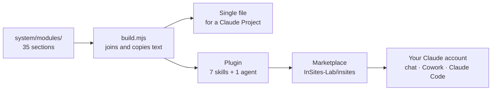

# InSites as a Claude plugin: how it is built

InSites is a **specification**: written instructions that a language model carries out stage by stage, with an expert review after each stage. The plugin is the same specification in different packaging. The stages, the stops, the epistemic marks and the session report are word for word the same as in the single-file edition. What changes is how the text is stored, loaded and delivered.

> **Development version.** It has been run on one assessment. It is not yet validated for formal assessments; use it at your own discretion.

## One source, two editions

The specification is edited as modules, one per section. A build script joins them into the single file or splits them into the plugin. The script only copies text and runs no code of its own, so what runs is still the specification. A check confirms that the joined modules equal the single file.

## Inside the plugin

| Part | What it holds | When it loads |
|---|---|---|
| `assess` skill | The core: role, governance, rules, notation. Stages 0–6 are stored as separate files | The core loads when an assessment starts and governs every turn after that. Each stage file is read when that stage begins, never ahead of it |
| Reference files | Value, context and change vocabularies; the Hebrew overlay; image analysis; the resume capsule | When a stage or the language calls for them |
| Product skills | `knowledge-graph`, `dashboard`, `read-assessment`, `read-collection`, `stage-spec`, `claim-extractor` | On their trigger (`kg`, `dashboard`, …). The core rules keep applying |
| `epistemic-auditor` agent | Checks a stage's marks against the sources in a separate, clean context. It flags and never rewrites | Only on request, and only in Cowork and Claude Code. In chat, `assess` re-checks itself and says so |

The knowledge graph and the dashboards are drawn by `atar-runtime`, a pinned package loaded from a CDN. This is the same in every edition.

## How it differs from the other editions

| Edition | What you load | What is in context | How a new version reaches you |
|---|---|---|---|
| **Claude Project** (single file) | One file pasted into the Project's instructions | The whole specification, every turn | A new file, replaced by hand in each Project |
| **Claude plugin** | Installed once to your account from the marketplace | The core, plus the stage or product currently in use | A version bump in the repository; installed copies pick it up through **Check for updates** |
| **Gemini Gem** | One file in the Gem's instructions | The whole specification | Replaced by hand |
| **Custom GPT** | `instructions.md` plus eight knowledge files, split because of the instruction field's size limit | The instructions, with the rest consulted as knowledge | Files re-uploaded by hand |

Only the two Claude editions are built from the modules. The Gemini and ChatGPT editions are maintained as separate ports. The modules are kept platform-neutral so that those editions can later be built from the same source.

The editions are ports of one architecture to different platforms. **They have not been compared, and nothing here claims that one runs an assessment better than another.**

## For a demo

- Install: **Customize → Plugins → Add → Add marketplace → `InSites-Lab/insites`**, then add **insites**.
- Start: upload the site documentation and say **begin assessment** (Hebrew: **התחל הערכה**). If it does not start, choose **assess** from the `/` menu.
- Use the plugin **or** the single file in a Project's instructions, never both. Two copies of the core rules in one conversation can disagree.
